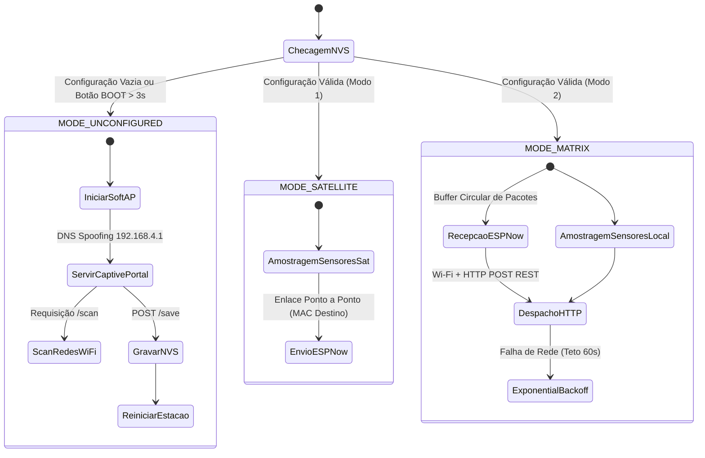

# OpenAir-AQStation: Estação Embarcada de Monitoramento da Qualidade do Ar em IoT

<div align="center">


**Sistema de Sensoriamento Ambiental Distribuído em Microescala Urbana de Baixo Custo**

[](https://github.com/henrique-1/OpenAir-AQStation/actions/workflows/build.yml)
[-0f4c5c.svg)](https://www.espressif.com/en/products/socs/esp32)
[-2a9d8f.svg)](https://platformio.org/)
[](LICENSE)

*Trabalho de Conclusão de Curso (TCC) — Bacharelado em Ciência da Computação*  
**Instituto Federal de Educação, Ciência e Tecnologia de São Paulo (IFSP) — Câmpus São João da Boa Vista**  
**Autor:** Henrique Bissoli Malaman Alonso  
**Orientador:** Prof. Dr. Breno Lisi Romano | **Coorientador:** Prof. Me. Everton Rafael da Silva

</div>

---

##  Sumário
1.  [Visão Geral do Projeto](#visão-geral-do-projeto)
2.  [Arquitetura de Software do Firmware](#arquitetura-de-software-do-firmware)
3.  [Sensores e Formulações Físico-Matemáticas](#sensores-e-formulações-físico-matemáticas)
4.  [Esquemático e Pinagem de Hardware](#esquemático-e-pinagem-de-hardware)
5.  [Compatibilidade de Hardware e Delimitações de Uso](#compatibilidade-de-hardware-e-delimitações-de-uso)
6.  [Compilação e Gravação](#compilação-e-gravação)
7.  [Comissionamento em Campo (Captive Portal Offline)](#comissionamento-em-campo-captive-portal-offline)
8.  [Integração com a Plataforma Web (OpenAir Metrics)](#integração-com-a-plataforma-web-openair-metrics)

---

##  Visão Geral do Projeto

O **OpenAir-AQStation** é a unidade de sensoriamento físico da solução **OpenAir Metrics**. O projeto visa mitigar a baixa densidade espacial das estações meteorológicas oficiais através de nós IoT autônomos, de baixo custo e alta confiabilidade para medição contínua da qualidade do ar em ambientes urbanos.

### Paradigmas de Engenharia Embarcada:
- **Máquina de Estados Finitos (FSM):** Modos operacionais estritamente separados para inicialização, comissionamento e aquisição.
- **Execução Não-Bloqueante (*Event-Driven*):** Todo o ciclo de execução é baseado em temporização por `millis()` e rotinas de interrupção por hardware (ISR), eliminando totalmente o uso de `delay()`.
- **Prevenção de Fragmentação de Heap:** Descarte de concatenação de objetos `String` em transmissões contínuas, priorizando buffers estáticos na pilha (`char[256]`) com `snprintf` e memória Flash (`PROGMEM`).
- **Comissionamento 100% Offline:** Ponto de Acesso Wi-Fi integrado com Captive Portal, scanner de redes dinâmico em tempo real e assets gráficos vetoriais/WebP embutidos na memória Flash.

---

##  Arquitetura de Software do Firmware

O firmware adota uma FSM com três modos operacionais persistidos na partição de **Memória Não-Volátil (NVS)** com mecanismo de *wear-leveling*:



### 1. `MODE_UNCONFIGURED` (Modo Ponto de Acesso / Captive Portal)
- O ESP32 ativa a interface em modo duplo (`WIFI_AP_STA`) com SSID `OpenAir-Station-XXXX` (derivado dos 2 últimos bytes do MAC físico).
- Um servidor DNS na porta 53 redireciona qualquer requisição HTTP para o IP local `192.168.4.1`.
- Fornece a rota `/scan`, permitindo ao usuário buscar as redes Wi-Fi da vizinhança em tempo real e visualizá-las ordenadas por intensidade de sinal no navegador.
- **Factory Reset:** Pressionar e segurar o botão **BOOT (GPIO 0)** por 3 segundos limpa as credenciais na NVS e retorna a estação a este modo com indicação luminosa no LED de status.

### 2. `MODE_SATELLITE` (Nó Transmissor ESP-NOW)
- O microcontrolador desliga o rádio Wi-Fi tradicional e opera exclusivamente sob o protocolo de enlace **ESP-NOW** da camada de enlace (IEEE 802.11).
- Encapsula as leituras locais de temperatura, umidade, $CO_2$ e $PM_{2.5}$ em um payload binário compacto de 24 bytes e transmite diretamente ao endereço MAC do nó receptor (Matriz ou nó intermediário em topologia cascata viária).

### 3. `MODE_MATRIX` (Nó Gateway Wi-Fi + API REST)
- Atua como concentrador: recebe telemetrias de múltiplos nós Satélites via ESP-NOW, coleta suas próprias leituras locais e despacha os dados para a nuvem.
- Comunicação segura com a API Web Laravel via método **HTTP POST** no endpoint configurado (padrão: `https://openair.bissoli.tech/api/medicoes`), transmitindo o token de segurança no cabeçalho `X-Sensor-Key`.
- **Mecanismo de Backoff Exponencial:** Caso o roteador perca conectividade com a internet, o sistema dobra os intervalos entre tentativas (de 5s até 60s), evitando retenção de recursos na CPU.

---

##  Sensores e Formulações Físico-Matemáticas

| Sensor | Grandeza Medida | Interface | Faixa Operacional | Resolução / Precisão |
| :--- | :--- | :--- | :--- | :--- |
| **MH-Z19C** | Dióxido de Carbono ($CO_2$) | UART2 (GPIO 16/17) | 400 a 5000 ppm | $\pm(50\text{ ppm} + 5\%)$ (NDIR Óptico) |
| **DSM501A** | Material Particulado ($PM_{2.5}$) | Digital ISR (GPIO 33) | 0 a 500 $\mu\text{g/m}^3$ | Espalhamento de Luz (*Light Scattering*) |
| **DHT22** | Temperatura e Umidade Relativa | Single-Bus (GPIO 26) | $-40\text{ a }80^\circ\text{C}$ / $0\text{ a }100\%$ | $0.1^\circ\text{C}$ / $0.1\%$ RH (Capacitivo) |

### Equações Implementadas no Firmware:

1. **Validação de Checksum e Saturação de $CO_2$ (MH-Z19C):**
   $$\text{Checksum Esperado} = \left( 0\text{xFF} - \sum_{i=1}^{7} \text{Byte}[i] \right) + 1$$
   $$\text{Concentração}_{CO_2} = (\text{Byte}[2] \times 256) + \text{Byte}[3] \quad [\text{ppm}]$$
   $$\text{Saturação da Ventilação (\%)} = \left( \frac{\text{Concentração}_{CO_2}}{1000\,\text{ppm}} \right) \times 100 \quad \text{(Ref: ANVISA RE nº 09/2003)}$$

2. **Razão de Ocupação em Nível Baixo (LPO) e Concentração $PM_{2.5}$ (DSM501A):**
   $$\text{Ratio}_{\text{LPO}} = \left( \frac{\Delta t_{\text{Low}}}{\Delta T_{\text{Janela}}} \right) \times 100 \quad (\Delta T_{\text{Janela}} = 30000\,\text{ms})$$
   $$N_p = 1{,}1 \cdot (\text{Ratio}_{\text{LPO}})^3 - 3{,}8 \cdot (\text{Ratio}_{\text{LPO}})^2 + 520{,}0 \cdot (\text{Ratio}_{\text{LPO}}) + 0{,}62 \quad [\text{pcs} / 0{,}01\text{ cf}]$$
   $$\text{PM}_{2.5}\,(\mu\text{g/m}^3) = N_p \times 3531{,}5 \times (5{,}8875 \times 10^{-7})$$

3. **Validação Sanitária do DHT22:**
   - Amostragem temporizada com intervalo mínimo garantido de $2500\,\text{ms}$.
   - Verificação de sanidade para descartar leituras espúrias `NaN` e limites físicos fora da escala operacional.

---

##  Esquemático e Pinagem de Hardware

A pinagem foi projetada para garantir compatibilidade eletroeletrônica e isolamento de barramentos internos:

```
                  +-----------------------------------+
                  |        ESP32 DOIT DEVKIT V1       |
                  |          (ESP-WROOM-32)           |
                  +-----------------------------------+
                                   |
         +-------------------------+-------------------------+
         |                         |                         |
  [Sensor DHT22]           [Sensor MH-Z19C]          [Sensor DSM501A]
  - Pin 1: 3.3V            - Vin: 5V (VIN)           - Pin 1: GND
  - Pin 2: GPIO 26 (Data)  - GND: GND                - Pin 3: 5V (VIN)
  - Pin 4: GND             - Pin 5 (RXD): GPIO 17    - Pin 4: GPIO 33 (LPO)
                           - Pin 6 (TXD): GPIO 16
```

### Tabela Resumo de Conexões:

| Dispositivo / Periférico | Pino no Sensor/Módulo | Pino no ESP32 | Tensão de Operação | Observações |
| :--- | :--- | :--- | :--- | :--- |
| **Sensor DHT22** | Pino 1 (VCC) | **3V3** | 3.3V DC | Alimentação lógica direta |
| | Pino 2 (SDA) | **GPIO 26** | 3.3V Lógico | Barramento de dados Single-Bus |
| | Pino 4 (GND) | **GND** | 0V | Terra comum |
| **Sensor MH-Z19C** | Vin | **VIN / 5V** | 5.0V DC | Aquecedor óptico NDIR exige 5V |
| | GND | **GND** | 0V | Terra comum |
| | TXD | **GPIO 16 (RX2)** | 3.3V Lógico | Canal receptor da UART2 |
| | RXD | **GPIO 17 (TX2)** | 3.3V Lógico | Canal transmissor da UART2 |
| **Sensor DSM501A** | Pino 1 (GND) | **GND** | 0V | Terra comum |
| | Pino 3 (VCC) | **VIN / 5V** | 5.0V DC | Resistor térmico de convecção |
| | Pino 4 (Signal Vout2) | **GPIO 33** | 3.3V / 5V (*) | Entrada com interrupção por hardware |
| **Status / Reset** | LED Onboard | **GPIO 2** | 3.3V | Indicador de AP e Heartbeat |
| | Botão BOOT | **GPIO 0** | Entrada Pull-up | Pressionar por 3s = Factory Reset |

> (*) O pino de saída Vout2 do DSM501A opera em coletor aberto ou nível TTL compatível; para maior proteção, recomenda-se divisor de tensão resistivo caso o lote do sensor forneça saída em 5V puro.

---

##  Compatibilidade de Hardware e Delimitações de Uso

> [!IMPORTANT]
> **Modelo de Referência Homologado:**
> O projeto foi desenvolvido, compilado e validado em campo utilizando o **ESP32 DOIT DevKit v1 com módulo ESP-WROOM-32** e chip conversor USB-Serial **CH9102X** (ou CP2102).

###  Placas 100% Compatíveis com os Binários Gerados
Os binários compilados pelo repositório ou pelo GitHub Actions funcionam de forma intercambiável em:
- **ESP32 DOIT DevKit v1** (versões de 30 ou 36 pinos, com CH9102X, CP2102 ou CH340);
- **ESP32 NodeMCU-32S**;
- Módulos **ESP-WROOM-32**, **ESP-WROOM-32D** e **ESP-WROOM-32U**;
- Qualquer placa de desenvolvimento baseada no microcontrolador **Xtensa Dual-Core LX6 clássico (ESP32-D0WDQ6 ou ESP32-D0WD)** com 4 MB de memória Flash.

###  Placas Incompatíveis (Não Gravar os Binários Padrão)
Não tente gravar os binários `.bin` padrão nestes modelos, pois possuem arquiteturas de processador totalmente diferentes:
- **ESP32-S2 / ESP32-S3:** Utilizam a arquitetura Xtensa LX7. A tentativa de gravação resultará em erro do *bootloader* ou *boot loop* perpétuo.
- **ESP32-C3 / ESP32-C6:** Utilizam arquitetura de processador **RISC-V**. O binário compilado para Xtensa LX6 não possui instruções compatíveis.
- **ESP8266 (NodeMCU ESP-12E):** Não possui o conjunto de instruções, memória RAM, nem os transceptores do rádio ESP-NOW nas mesmas faixas, além de não possuir duas portas seriais UART independentes.

###  Alerta Especial: ESP32-WROVER (Módulos com PSRAM)
Se for utilizar uma placa do modelo **ESP32-WROVER** (que possui chip de memória PSRAM externa de 4MB ou 8MB acoplada):
- Os pinos **GPIO 16 e GPIO 17** são utilizados **internamente** pelo barramento SPI da PSRAM.
- Ligar a UART2 do sensor MH-Z19C nos pinos 16 e 17 no WROVER causará *crash* imediato ao tentar ler a memória.
- **Solução no WROVER:** É necessário remapear a UART2 para outros pinos livres (como GPIO 4 e 5) no arquivo `include/Config.h` e recompilar o código-fonte.

---

##  Compilação e Gravação

Você pode gravar a estação de duas maneiras: utilizando os binários prontos gerados pelo GitHub Actions ou compilando o código-fonte localmente via PlatformIO.

### Método 1: Gravação via Navegador (Sem Instalar Nada)
Com o recurso de **Web Serial API** suportado no Google Chrome, Microsoft Edge ou Opera:
1. Conecte o ESP32 na porta USB do computador.
2. Acesse uma ferramenta de gravação Web Serial, como [ESP Web Tools](https://esphome.github.io/esp-web-tools/) ou [Adafruit ESPTool](https://adafruit.github.io/Adafruit_WebSerial_ESPTool/).
3. Baixe os artefatos compilados na aba **Actions** ou **Releases** deste repositório:
   - `bootloader.bin`
   - `partitions.bin`
   - `firmware.bin`
4. Mapeie os arquivos para seus respectivos offsets de memória:
   - **`0x1000`** &rarr; `bootloader.bin`
   - **`0x8000`** &rarr; `partitions.bin`
   - **`0x10000`** &rarr; `firmware.bin`
5. Clique em **Program / Flash**. Em poucos segundos a estação estará pronta!

### Método 2: Gravação via Linha de Comando (`esptool.py`)
Caso prefira gravar diretamente pelo terminal:
```bash
pip install esptool
esptool.py --chip esp32 --port /dev/ttyUSB0 --baud 921600 write_flash \
  0x1000 bootloader.bin \
  0x8000 partitions.bin \
  0x10000 firmware.bin
```
*(No Windows, substitua `/dev/ttyUSB0` pela porta correspondente, ex: `COM3`).*

### Método 3: Compilação a partir do Código-Fonte (PlatformIO)
Se você for modificar o código, alterar pinos ou adicionar sensores:
1. Instale o [Visual Studio Code](https://code.visualstudio.com/) e a extensão **PlatformIO IDE**.
2. Clone o repositório:
   ```bash
   git clone https://github.com/henrique-1/OpenAir-AQStation.git
   cd OpenAir-AQStation
   ```
3. Compile o projeto:
   ```bash
   pio run
   ```
4. Conecte o ESP32 via cabo USB e grave:
   ```bash
   pio run -t upload
   ```
5. Abra o monitor serial para verificar a telemetria:
   ```bash
   pio device monitor -b 115200
   ```

---

##  Comissionamento em Campo (Captive Portal Offline)

Toda a interface de configuração opera **100% autônoma** e não depende de internet no smartphone ou no ESP32:

```
  [ Celular do Usuário ]
            |
            | Conecta via Wi-Fi no AP
            v
  [ OpenAir-Station-XXXX ]  --->  Abre 192.168.4.1 (Captive Portal)
                                  - Imagens em WebP servidas da Flash
                                  - Ícones Heroicons embutidos em SVG Inline
                                  - Endpoint /scan varre redes ao redor
```

1. Ligue a estação. Se ela estiver desconfigurada, o LED onboard piscará a cada 500ms e uma rede Wi-Fi aberta chamada `OpenAir-Station-XXXX` será emitida.
2. Conecte seu smartphone ou computador a essa rede (senha padrão: `openair123`).
3. Uma notificação de "Fazer login na rede" será disparada no dispositivo móvel, abrindo a página de configuração automaticamente. Caso não abra, acesse `http://192.168.4.1/`.
4. Escolha a função da estação:
   - **Satélite:** Digite o MAC Address de destino do nó concentrador (a máscara `AA:BB:CC:DD:EE:FF` é aplicada automaticamente).
   - **Matriz:** Clique em **Buscar Redes**. O ESP32 listará os Wi-Fis próximos indicando a qualidade do sinal (ícones com cores graduadas) e a segurança. Selecione a rede desejada e digite a senha.
5. Clique em **Salvar e Iniciar Estação**. Os parâmetros são persistidos atomicamente na memória Flash (NVS), o Ponto de Acesso é desligado para segurança e a estação entra em modo contínuo de sensoriamento.

> **Teste Prévio no PC:** O layout e o comportamento do portal podem ser validados no navegador antes do upload abrindo o arquivo `tools/portal_preview.html` (`xdg-open tools/portal_preview.html`).

---

##  Integração com a Plataforma Web (OpenAir Metrics)

Quando operando em modo Matriz, o firmware despacha requisições HTTP RESTful para a aplicação web em Laravel:

- **Endpoint:** `POST /api/medicoes`
- **Cabeçalhos Exigidos:**
  - `Content-Type: application/json`
  - `Accept: application/json`
  - `X-Sensor-Key: TELEMETRY_API_KEY`
- **Exemplo de Carga Útil (Payload JSON):**
  ```json
  {
    "mac_address": "24:6F:28:B2:1A:4C",
    "temperatura": 24.85,
    "umidade": 58.20,
    "co2": 520,
    "poeira": 12.40
  }
  ```

---

##  Licença e Créditos

Este projeto é distribuído sob a licença **MIT**. Consulte o arquivo `LICENSE` para mais informações.

Desenvolvido no âmbito das pesquisas de graduação em Ciência da Computação do **Instituto Federal de São Paulo (IFSP)**.
Para detalhes metodológicos aprofundados, ensaios de estanqueidade mecânica no abrigo lamelar e validação metrológica em campo, consulte o relatório técnico completo do TCC disponível na biblioteca do IFSP.
